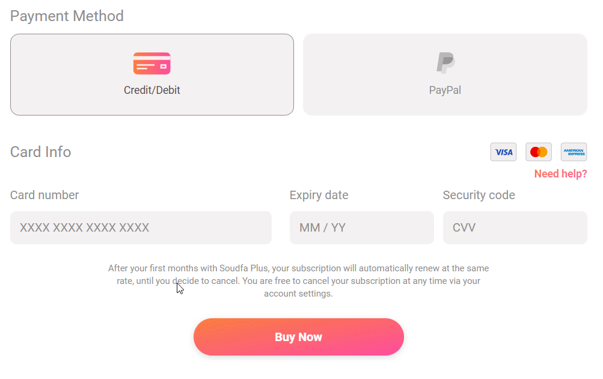

# Lesson plan
```
> Focus on having lots of in-class exercises. Ideally, half the time should be used on exercises.

> DON'T teach everything; let the trainees investigate topics on their own as well!

> Emphasize how to read documentation, search for answers, and debug errors!

> Teach towards enabling trainees to solve the homework assignments.

> Alternate between teaching and exercises. Avoid long lectures; most people can't focus for more than 45 minutes.
```

This class is about getting the basics hammered down. We have had a lot of students who think the js module is too difficult. That is why this class is here, too ease the steepness of the js learning curve. 

```
Focus on 
> Recapping what the students struggle with
> Letting the students learn a framework for solving problems
> Lots and lost of exercises 💪
```

> [!IMPORTANT]
> If you find anything that could be improved then please create a pull request! We welcome changes, so please get involved if you have any ideas!

## Suggested Lesson Plan

You can find a suggested lesson plan [here](./lesson.md). 

Feel free to use your own lesson plan if it works better for your teaching style. Just ensure that you cover [the learning goals](./readme.md). 

# Old material

### Fizz buzz

This is a classic programming task. 

Create a function that prints the numbers from 1 to 100. But for multiples of three print `Fizz` instead of the number and for the multiples of five print `Buzz`. For numbers which are multiples of both three and five print `FizzBuzz`.

When that works. Make the two number for multiples into parameters. So it can be called like this:

`fizzBuzz(4, 12);`


### Credit card number formatter

This is a very real world example of a problem i got at my previous work. I was tasked to implement one of the smart credit card input fields, where the credit card numbers are seperated with a space. Fx inputting 123456789 would show 1234 5678 9.



Create a function that takes a number as parameter. The function should return the following object:

```js
const formattedCreditCardObject = formatCreditCardNumber(123456789);
console.log(formattedCreditCardObject);
/*
{
  original: 123456789,
  formatted: "1234 5678 9",
}
*/
```

Thins to consider:
- What should happen if the function is called with an argument that is not a number?

### Character frequencies

Write a function that counts the frequency of characters in a string:

```js
console.log(getCharacterFrequencies('happy'));
/*
{
  characters: [
    {
      character: 'a',
      count: 1
    },
    {
      character: 'h',
      count: 1
    },
    {
      character: 'p',
      count: 2
    },
    {
      character: 'y',
      count: 1
    }
  ], length: 5
}
*/
```

### Palindromic substring
Write a function that finds the longest palindromic substring of a given string. 


### Credit card info

Similar to the format credit card number, now we need to identify the credit card type. 

```js
console.log(getCardInfo(4781321334789876)); // 'visa'
```

How can we find out what rules there are for credit cards? Programmers best friend is always available :) 

### Tic Tac Toe

Draw a tic tac toe game.

Write a function called `getRenderedGame(position)` that takes `position` as parameter. `position` is a two dimensional array that shows the position of a game.

Here is an example:

With the following two dimensional array 
```js
const position = [
  ['x', 'o', ' '],
  [' ', 'o', ' '],
  [' ', 'o', 'x']
];

const renderedGame = getRenderedGame(position);
console.log(renderedGame);

/*
*******
*x*o* *
* *o* *
* *o*x*
*******
*/
```

Create a new function called `getGameinfo(position)`. Calling the function should return an object with `winner` key, `loser` key, `hasEnded` and `nextPlayer`.

EXAMPLES!!!!


```js
const position = [
  ['x', 'o', ' '],
  [' ', 'o', ' '],
  [' ', 'o', 'x']
];

const gameInfo = getGameinfo(position);
console.log(gameInfo);

/*
{
  winner: 'o',
  loser: 'x',
  hasEnded: true
}
*/
```


```js
const position = [
  ['x', 'o', ' '],
  [' ', ' ', ' '],
  [' ', 'o', 'x']
];

const gameInfo = getGameinfo(position);
console.log(gameInfo);

/*
{
  winner: undefined,
  loser: undefined,
  hasEnded: false
}
*/
```

Try and make the game playable! *optional*


### Conway's game of life *optional*

https://en.wikipedia.org/wiki/Conway%27s_Game_of_Life

And finally, feel free to fill out the form to help us improve the module and the exercises. The [survey](https://forms.gle/irckYkBdvSb6Tdz57) here is addressed to the teacher and teacher assistant, while this [survey](https://forms.gle/ttdDLcSJ88ksz6xe7) is for homework helpers.
